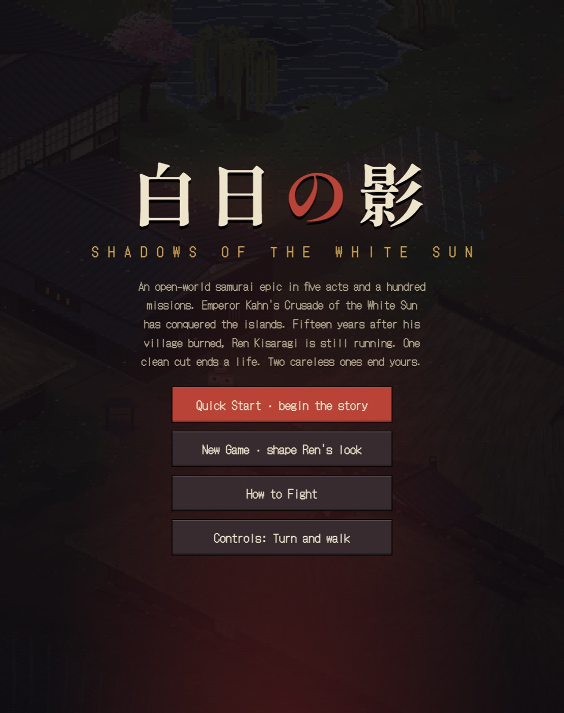
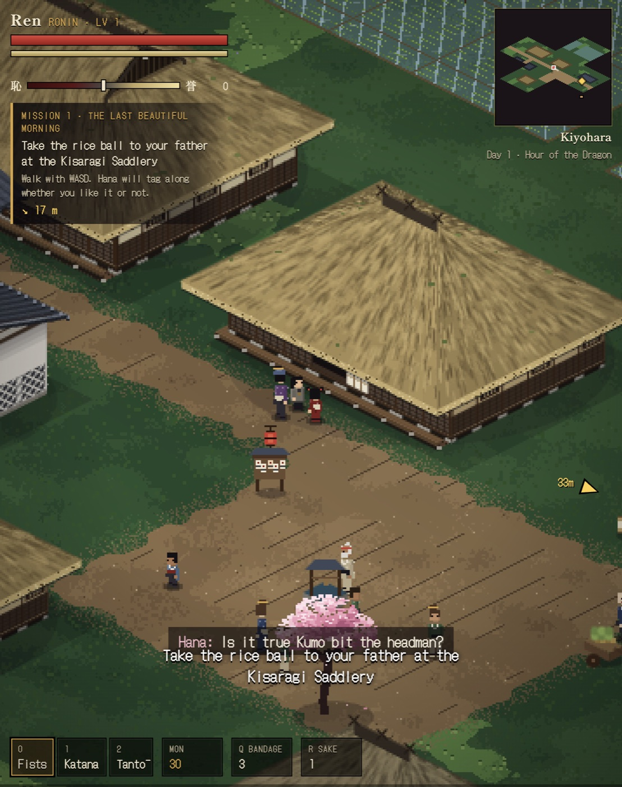
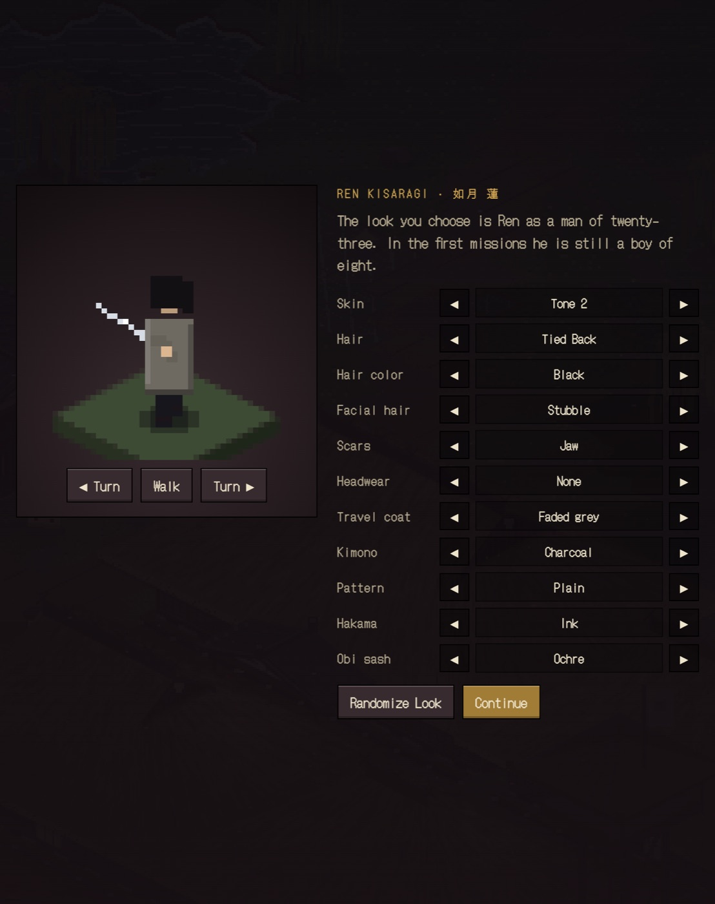
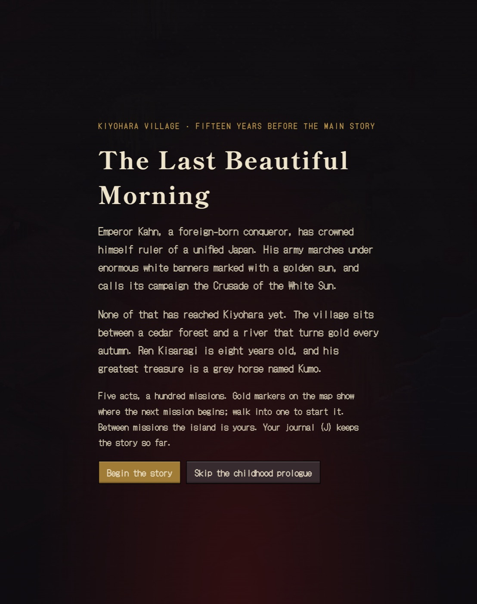
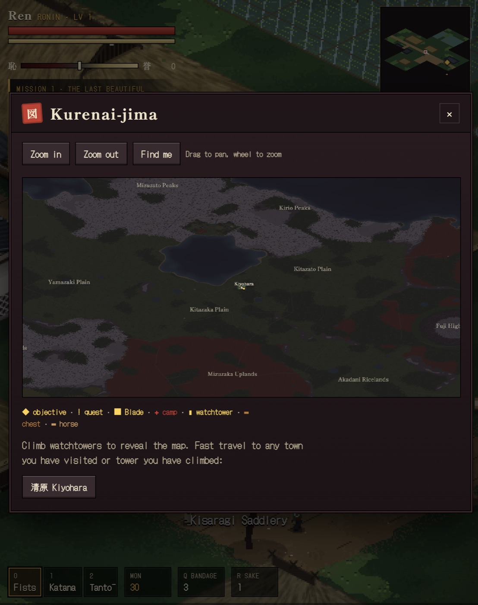
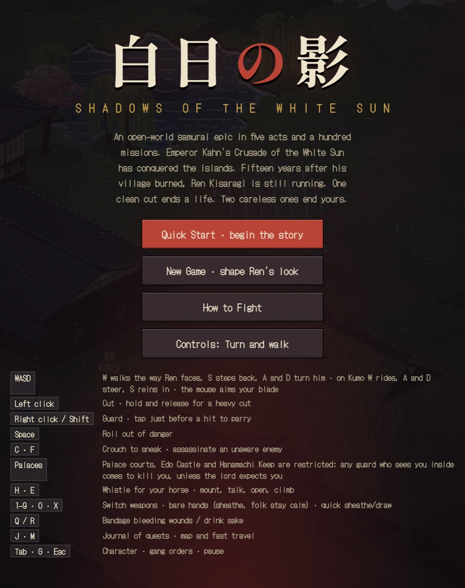

# Crimson Ronin

**白日の影 · Shadows of the White Sun**

A single-file open-world samurai RPG in the browser. You play **Ren Kisaragi**, a boy from a mountain village whose world is burned by Emperor Kahn’s Crusade of the White Sun — and, fifteen years later, the ronin who is still running.

<p align="center">
  
</p>

There is no build step, no package manager, and no server required. Open `Crimson Ronin.html` in a modern browser and the island of **Kurenai-jima** raises itself.

---

## Overview

Crimson Ronin is a complete action-adventure in one HTML file: an isometric pixel-art world, a hundred-mission story, and a sandbox around it.

Emperor Kahn, a foreign-born conqueror, has crowned himself ruler of a unified Japan. His army marches under enormous white banners marked with a golden sun. None of that has reached **Kiyohara** yet — a village between a cedar forest and a river that turns gold every autumn. Ren is eight. His greatest treasure is a grey horse named **Kumo**.

The first missions play that last beautiful morning, then the fire. The rest of the game is the man Ren becomes: a wandering blade on an island of occupied towns, hidden shrines, bandit camps, and people who still remember his name.

Between story missions the island is yours. Gold markers on the map show where the next chapter begins. Walk into one to start it. Your journal keeps the story so far.

### The five acts

| Act | Title | Missions |
| --- | --- | --- |
| I | **The Boy Who Survived** · 生き残った少年 | 1–20 |
| II | **The People Left Behind** · 置き去りの人々 | 21–40 |
| III | **The Cannonier’s Sin** · 砲手の罪 | 41–60 |
| IV | **The Last Lanterns** · 最後の灯 | 61–80 |
| V | **The Fall of the White Sun** · 白日の落日 | 81–100 |

---

## Screenshots

<p align="center">
  
</p>

<p align="center"><em>Kiyohara, Hour of the Dragon. Hana tags along whether you like it or not.</em></p>

<p align="center">
  
</p>

<p align="center"><em>Shape Ren’s look as a man of twenty-three. In the first missions he is still eight.</em></p>

<p align="center">
  
</p>

<p align="center"><em>The childhood prologue can be played or skipped from this screen.</em></p>

<p align="center">
  
</p>

<p align="center"><em>The island of Kurenai-jima. Climb watchtowers to reveal the map; fast-travel to towns you have visited.</em></p>

<p align="center">
  
</p>

<p align="center"><em>How to Fight, from the title screen. One clean cut ends a life. Two careless ones end yours.</em></p>

---

## How to run

The game is the file **`Crimson Ronin.html`**. That is the whole project.

### Fastest: open the file

1. Clone or download this repository.
2. Double-click `Crimson Ronin.html`, or drag it onto Chrome, Firefox, Safari, or Edge.
3. Wait for the title screen to finish *Drawing the map…* / *Raising the realm…*, then choose **Quick Start** or **New Game**.

A recent desktop or mobile browser is enough. There is nothing to install.

### From a local server (recommended)

Some browsers are stricter with `file://` URLs (fonts, audio, or saves). Serving the folder over HTTP avoids that:

```bash
cd CrimsonRoninRepo
python3 -m http.server 8000
```

Then open [http://localhost:8000/Crimson%20Ronin.html](http://localhost:8000/Crimson%20Ronin.html).

Any static file server works (`npx serve`, Caddy, nginx, GitHub Pages, and so on).

### Starting a run

| Button | What it does |
| --- | --- |
| **Quick Start · begin the story** | Jump straight into the campaign with the default look. |
| **New Game · shape Ren’s look** | Customize hair, kimono, scars, and coat, then begin. |
| **Gang / Multiplayer** | Shared persistent world. No story campaign. Side quests, a gang camp, and friends on one island. |
| **How to Fight** | Show the control list on the title screen. |
| **Controls** | Toggle **Turn and walk** (W walks the way Ren faces) vs **Classic** (WASD strafes, mouse aims). |

On the intro card you can **Begin the story** (childhood in Kiyohara) or **Skip the childhood prologue**.

Progress is written to the browser’s `localStorage`. **Continue the Journey** appears on the title screen once a save exists. Pause with `Esc` to save and return to title.

### Gang / Multiplayer (shared world)

Story mode still runs from the HTML file alone. **Gang / Multiplayer** needs the Node world server so every browser shares one persistent Kurenai.

```bash
docker compose up
```

Then open [http://127.0.0.1:8091/](http://127.0.0.1:8091/) (or `http://127.0.0.1:8091/crimson-ronin/`). WebSocket is `/ws` and `/crimson-ronin/ws`. The compose file binds **127.0.0.1:8091** only, so a later Caddy reverse-proxy on the leo VM can front `/crimson-ronin/` without nginx.

Without Docker:

```bash
cd server && npm install && PORT=8091 BIND=127.0.0.1 node index.js
```

You spawn at your gang camp (a tree-cleared patch near a town, never Kuroba-dera). The map is fully revealed. Fast travel exists only back to camp. Side quests are repeatable with friends; starting one pulls nearby gangmates in. Pause (`Esc`) to invite by name or id. Two riders can share one horse (saddle + mount behind). Camp buildings are bought damaged, then upgraded with mon from side work. Sleep in the quarters to heal. Closing the tab does not wipe the world (`server/data/world.json`).

---

## Controls

Two movement schemes. Switch them on the title screen or from the pause menu.

**Turn and walk (default)** — W walks the way Ren faces, S steps back, A and D turn him. On Kumo, W rides, A and D steer, S reins in. The mouse aims the blade.

**Classic** — WASD moves Ren across the screen; he faces the mouse.

| Input | Action |
| --- | --- |
| Left click | Cut. Hold and release for a heavy cut. |
| Right click / Shift | Guard. Tap just before a hit to parry. |
| Space | Roll out of danger. |
| C / F | Crouch to sneak / assassinate an unaware enemy. |
| H / E | Whistle for your horse / mount, talk, open, climb. |
| 1–9 · 0 · X | Switch weapons · bare hands (folk stay calm) · quick sheathe/draw. |
| Q / R | Bandage bleeding wounds / drink sake. |
| J / M | Journal of quests / map and fast travel. |
| Tab · G · Esc | Character · gang orders · pause. |

On a phone or tablet, a virtual stick and face buttons appear. Palaces, Edo Castle, and Hanamachi Keep are restricted: a guard who sees you inside will try to kill you, unless the lord expects you.

---

## What you can do on the island

- **Fight** with timed cuts, heavy blows, parries, and rolls. Wounds bleed. Bandage them or they will finish you.
- **Sneak** through camps and palaces, or walk in with a sheathed blade so townsfolk stay calm.
- **Ride Kumo**, whistle him back, and cross the island instead of walking it.
- **Keep honor** on a scale from Oni to Kensei. Mercy, duels, and how you treat the helpless all count. Shame closes some doors.
- **Challenge the Ten Blades** in formal iaijutsu standoffs — wait for 斬, then click.
- **Rebuild Kuroba-dera**, hire a gang at inns, and give them orders with G.
- **Explore** plains, bamboo, snow passes, castle towns, maple woods, and the coast. Climb watchtowers to unfog the map.
- **Learn techniques** as you level: Iron Body, Iaijutsu, Willow Guard, Shadow Walker, and more.
- **Play side work** — parcels, warrants, bandit camps, rumors at the inn, chō-han in the back room — between the hundred story missions.

The world is the island of Kurenai-jima, thousands of tiles on a side, with a hand-built heartland around Ashigawa and generated provinces beyond it.

---

## Project layout

```
CrimsonRoninRepo/
├── Crimson Ronin.html    # the entire game: world, story, renderer, audio, UI
├── compose.yaml          # static HTML + Gang WebSocket on 127.0.0.1:8091
├── server/               # Node world host (ws, JSON save in server/data/)
├── README.md
├── .gitignore
└── docs/screenshots/     # images used in this README
```

Everything playable lives in `Crimson Ronin.html`: isometric renderer, procedural island, mission scripts, dialogue, combat, audio, HUD, and saves. Google Fonts (`DotGothic16`, `Shippori Mincho B1`) load from the network when available; the game still runs if they do not.

---

## Tips

- One clean cut ends a life. Two careless ones end yours.
- Sheathe with `0` (fists) in town if you do not want a panic.
- Gold map markers are story. The rest of the island does not wait for you.
- Press `J` when you lose the plot. The Story tab is a recap, not a spoiler dump you have not earned yet.
- If the title screen sits on *Raising the realm…*, give it a few seconds — the island is large.

---

Play well. Give them something worth knowing.
